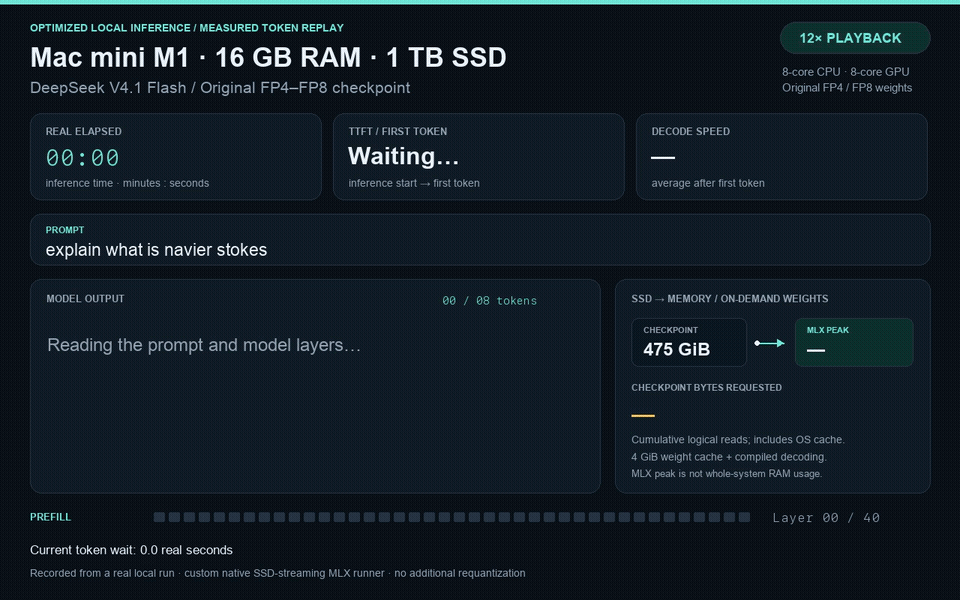

# DeepSeek V4.1 Flash on a 16 GB M1 Mac mini

**475 GiB of original FP4/FP8 weights. A 16 GB Mac. About 23 seconds per token.**

This is the recipe and experimental runner behind a real local inference demo.
It streams the official DeepSeek V4.1 Flash checkpoint from SSD, reading only
selected experts and Engram lookup rows, with bounded memory for dense weights.
There is no additional quantization or smaller replacement model.

[](assets/navier-stokes-mac-mini-optimized.mp4)

[Download the MP4](https://raw.githubusercontent.com/atbender/deepseek-v41-flash-mac-mini/main/assets/navier-stokes-mac-mini-optimized.mp4).
The animation is a **12× replay of measured token and layer timestamps** from
an eight-token run, with a four-second final hold. The SSD arrow is a schematic,
not a physical I/O utilization meter. [Raw recording](benchmarks/confirm8.jsonl).

## What actually ran

- Mac mini M1: 8 CPU cores, 8 GPU cores, 16 GB unified memory, internal 1 TB SSD.
- macOS 26.5.2, Python 3.12, MLX 0.32.2, mlx-lm 0.31.3.
- Official [DeepSeek-V4.1-Flash](https://huggingface.co/deepseek-ai/DeepSeek-V4.1-Flash),
  revision `dba1be0a40aa45a94ad051997016db3960a90277`.
- About 510 GB decimal / 475 GiB of checkpoint data across 48 safetensors shards.
- Text-only, greedy decoding, native FP4 routed experts and FP8 dense/Engram weights.
- Prompt: `explain what is navier stokes`.

The model's transformer math comes from
[PipeNetwork's MLX port](https://github.com/PipeNetwork/deepseek-v41-mlx), pinned
at `8bdd543c7160800f3451d9595c996129b7abecdf`. This repository adds the bounded
SSD execution path and the optimization experiments. Inspiration came from
[antirez's local inference demo](https://x.com/antirez/status/2098121665771110540).
This is an independent experiment, not DwarfStar or an official DeepSeek runtime.

## Reproduce

### 1. Prepare an Apple Silicon Mac

Use a fast local SSD with **at least 550–600 GB free before downloading**.
The weights alone take about 510 GB; leave room for the environment and macOS.
The experiment used the internal SSD. External drives have not been benchmarked.

Install Apple's Command Line Tools if needed (`xcode-select --install`), and
install [uv](https://docs.astral.sh/uv/getting-started/installation/), for example
with `brew install uv` if you already use Homebrew.

```sh
git clone https://github.com/atbender/deepseek-v41-flash-mac-mini.git
cd deepseek-v41-flash-mac-mini
uv venv --python 3.12
uv pip install --python .venv/bin/python -r requirements.txt
```

The versions are the ones used in this experiment. The upstream port requested
mlx-lm 0.32 or newer; 0.31.3 was the available version used here and passed the
included numerical tests.

### 2. Download the original weights

```sh
mkdir -p models/DeepSeek-V4.1-Flash
.venv/bin/hf download deepseek-ai/DeepSeek-V4.1-Flash \
  --revision dba1be0a40aa45a94ad051997016db3960a90277 \
  --include '*.safetensors' --include '*.json' --include LICENSE --include README.md \
  --local-dir models/DeepSeek-V4.1-Flash
```

This is a roughly 510 GB download. Rerun the same command if interrupted; the
Hub client can reuse completed files. Keep every shard referenced by
`model.safetensors.index.json`, plus the configuration and tokenizer files.
The original experimental download was SHA-256 checked for all 48 shards.
Do **not** run the full-model conversion or resident loading utilities on this
16 GB machine: the native streaming entry point below reads the original files.

### 3. Run a short example

```sh
mkdir -p runs
caffeinate -i .venv/bin/python -u -m deepseek_v41_mlx.native_stream \
  models/DeepSeek-V4.1-Flash \
  --prompt 'explain what is navier stokes' --max-tokens 8 \
  --reuse-allocator --dense-cache-gib 4 --compile-dequant \
  | tee runs/navier-stokes.jsonl
```

Expect roughly 4½ minutes for this eight-token example on the measured machine.
The first launch may also build a tokenizer lookup map before inference starts.
JSONL output contains layer progress, cumulative generated text, token IDs,
timings, logical bytes read, and memory measurements.

```sh
.venv/bin/python scripts/extract_answer.py runs/navier-stokes.jsonl
```

### 4. Leave it generating

```sh
nohup caffeinate -i .venv/bin/python -u -m deepseek_v41_mlx.native_stream \
  models/DeepSeek-V4.1-Flash \
  --prompt 'explain what is navier stokes' --max-tokens 2048 \
  --reuse-allocator --dense-cache-gib 4 --compile-dequant \
  > runs/overnight.jsonl 2>&1 < /dev/null &
echo $!
```

At the short-run speed, the full 2,048-token allowance would take about 13 hours.
That is an extrapolation: longer runs can change speed and memory use. Generation
stops earlier on the model's end token. `nohup` lets it survive disconnecting an
SSH session; `caffeinate` prevents idle sleep while the process runs. The log
retains progress, but inference state is not checkpointed for restart after a
crash or reboot. Do not run multiple copies concurrently on a 16 GB machine.

## Optimization results

| Configuration | TTFT | Decode seconds/token | Peak active MLX memory |
|---|---:|---:|---:|
| Original streaming | 128.3 s | 30.7 | 1.67 GiB |
| Reuse allocation buffers | 125.9 s | 27.9 | 1.67 GiB |
| + 4 GiB dense weight cache | 126.4 s | 26.3 | 5.65 GiB |
| + 6 GiB dense weight cache instead | 126.9 s | 25.6 | 6.62 GiB |
| 4 GiB cache + compiled weight decoding | 108.2 s | 22.6 | 5.65 GiB |
| Same optimized settings, eight-token repeat | **108.3 s** | **22.8** | **5.65 GiB** |

The repeat reduced seconds/token by about **26%** (about **1.35× throughput**)
relative to the fresh baseline. All four-token runs returned identical token IDs;
the eight-token repeat matched the first eight tokens of the original longer demo.

These are short, sequential exploratory measurements, not randomized repeated
trials. The screening runs measured three decode steps; the repeat measured
seven. Other applications remained open, and the OS file cache was not purged.
TTFT starts after tokenizer/runner initialization. Decode averages exclude TTFT.
[Raw benchmark logs](benchmarks/) are included so the numbers can be checked.

**MLX memory is not total system RAM usage.** Its active allocation counter
excludes macOS's file cache, other applications, and free allocation buffers.
The 4 GiB cache caused system swap usage to rise to roughly 1.8 GiB during its
screening run; the 6 GiB setting reached roughly 3.4 GiB for a small extra gain.
Swap can remain occupied after generation ends. If memory pressure is high,
reduce `--dense-cache-gib` to `2` or `0`; those settings are available, though
compiled decoding with those cache sizes was not benchmarked here.

To reproduce the original low-memory mode, omit all three optimization flags.
The runner caps MLX allocations at 8 GiB and its free allocation cache at
256 MiB. These are not whole-system memory caps.

## How the runner fits

1. Parse the safetensors index and headers, then use bounded `pread` calls.
2. Build one transformer layer at a time; retain a bounded subset of decoded
   dense matrices between tokens. Cache admission is stable first-fit, not LRU.
3. Read only the six routed experts selected for each token in each layer.
   Decode and evaluate expert projections individually, then release them.
4. Fetch only the hashed rows needed from the two enormous Engram tables.
5. Preserve KV and cross-layer state; project the output vocabulary in chunks.
6. Reuse allocator buffers and compile FP4/FP8 decoding with `mx.compile`.

The checkpoint stays in its original format. Selected weights are decoded on
the fly for computation. Logical read counters include OS-cache hits; they do
not measure physical SSD traffic. The code does not yet prefetch weights or
cache routed experts adaptively.

## Correctness and limits

```sh
uv pip install --python .venv/bin/python -r requirements-test.txt
.venv/bin/python tests/test_parity.py
.venv/bin/python tests/test_native_stream.py
```

The upstream tiny-model reference suite checks prefill, cached decode, routing,
compression, and quantization. Its reference adaptations are documented in
[the upstream notes](docs/upstream-notes.md). The added streaming test compares
native FP4/FP8 execution against a resident tiny model, including Engram lookup,
20-token prefill, two single-token decode steps, and a three-token append.
Cached/compiled and uncached logits were identical in this test; the resident
comparison passed a relative error threshold of 1e-5.

The M1 needed exact IEEE bit construction for exponent-only scales in
`dequant.py`; `pow()` did not pass the bit-exact scale test.

This does **not** validate full-size logits against DeepSeek's production
implementation, long-context quality, vision, tool use, or DSpark speculative
decoding. Vision and optional draft-network computation are not executed by
this runner. It is a slow experiment, not an optimized serving system.

## Demo source

The video renderer uses Pillow and FFmpeg on macOS. It reconstructs the timeline
from real benchmark events and strips Markdown emphasis markers for display.

```sh
uv pip install --python .venv/bin/python pillow
# Install ffmpeg separately, e.g. brew install ffmpeg
.venv/bin/python scripts/render_demo.py benchmarks/confirm8.jsonl \
  --optimized --speed 12 --out assets/navier-stokes-mac-mini-optimized.mp4
```

## Credits and licenses

- [PipeNetwork/deepseek-v41-mlx](https://github.com/PipeNetwork/deepseek-v41-mlx):
  upstream MLX model implementation and reference tests, Apache-2.0.
- [DeepSeek](https://huggingface.co/deepseek-ai/DeepSeek-V4.1-Flash): model,
  tokenizer, and reference implementation. Model/reference terms are MIT.
- [MLX](https://github.com/ml-explore/mlx): Apple Silicon array framework.

See [LICENSE](LICENSE), [NOTICE](NOTICE), and
[reference license](docs/reference/LICENSE). Model weights are downloaded from
the original publisher and are not included in this repository.
